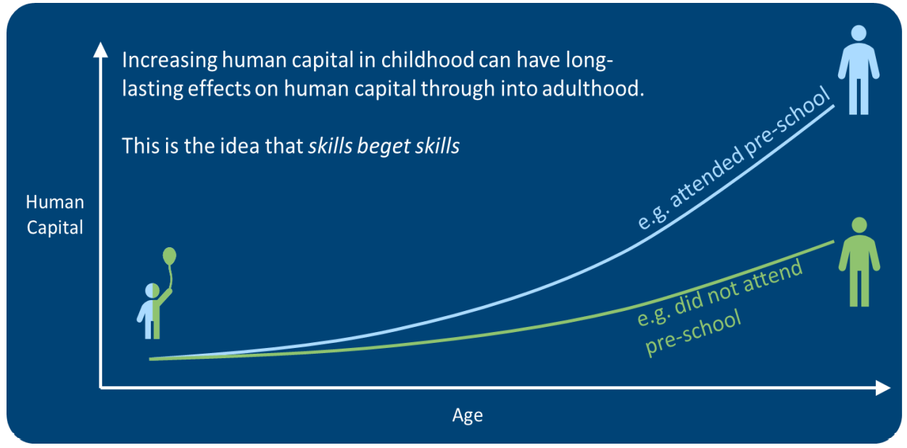

## Iechyd a chyfalaf cymdeithasol a dynol

Gwyddys bod cyfalaf dynol a chyfalaf cymdeithasol yn cael effaith ar iechyd a lles. [Mae tystiolaeth o Ewrop](https://www.euro.who.int/__data/assets/pdf_file/0005/170078/Is-Social-Capital-good-for-your-health.pdf) yn awgrymu y gall ymyriadau polisi sydd wedi'u targedu at wella cyfalaf cymdeithasol unigol wella iechyd unigolion yn uniongyrchol a chyfrannu at gyfalaf cymdeithasol cymunedol, gan atgyfnerthu rôl fuddiol cyfalaf cymdeithasol unigol.

**Cyfalaf Dynol**

Mae diffiniadau o gyfalaf dynol yn cwmpasu'r syniad y ceir buddsoddiadau mewn pobl fel addysg, hyfforddiant neu iechyd, a bod y buddsoddiadau hyn yn cynyddu cynhyrchiant unigolyn. Cyfalaf dynol yw gwerth sgiliau, gwybodaeth, galluoedd, rhinweddau cymdeithasol, personoliaeth a phriodoleddau iechyd unigolion. Mae'r ffactorau hyn yn galluogi unigolion i weithio, ac felly cynhyrchu rhywbeth o werth economaidd. Fe'i mesurir fel swm cyfanswm enillion posib pawb yn y farchnad lafur yn y dyfodol. Mae'r Swyddfa Ystadegau Gwladol yn [cynhyrchu amcangyfrifon cyfalaf dynol ar gyfer y DU](https://www.ons.gov.uk/releases/humancapital). 

Mae cyfalaf dynol yn cronni trwy gydol oes a gall profiadau plentyndod cynnar gael effeithiau gydol oes, gweler Ffigur 1.

**Ffigur 1:  Effeithiau cyfansawdd ennill cyfalaf dynol drwy gydol oes. Ffynhonnell:** [Ymgynghoriad ar Ddangosyddion Cyfalaf Dynol y Swyddfa Ystadegau Gwladol](https://consultations.ons.gov.uk/well-being-inequalities-sustainability-and-environment/indicator-based-approach-to-measuring-human-capita/supporting_documents/Human_capital_consultation_final.pdf)

Mae Prifysgol Harvard wedi cynhyrchu crynodeb o [sut i roi hwb i gyfalaf dynol a'r ffactorau sy'n bwysig](https://scholar.harvard.edu/files/goldin/files/human_capital_handbook_of_cliometrics_0.pdf), gan gynnwys: addysg; hyfforddiant galwedigaethol; hinsawdd o greadigrwydd; a seilwaith. Yn y DU, mae'r Sefydliad Siartredig Personél a Datblygu (CIPD) wedi cyhoeddi'n eang ar gyfalaf dynol. Mae adroddiad [technegol CIPD ar ddamcaniaeth cyfalaf dynol](https://www.cipd.co.uk/Images/human-capital-theory-assessing-the-evidence_tcm18-22292.pdf) yn cyflwyno'r achos dros fuddsoddi mewn pobl fel unigolion ac o'r lefel sefydliadol, ac yn darparu cyfres o argymhellion ar gyfer gwella cyfalaf dynol gan gynnwys: hyfforddiant ffurfiol; mentora; anogaeth; tracio hwyliau a chynhyrchiant; a rheoli doniau i gadw cyfalaf dynol o fewn sefydliad neu leoliad. 

**Cyfalaf Cymdeithasol**

[Cyfalaf cymdeithasol](https://www.euro.who.int/__data/assets/pdf_file/0005/170078/Is-Social-Capital-good-for-your-health.pdf) yw'r rhwydweithiau o berthnasoedd ymhlith pobl sy'n byw ac yn gweithio mewn cymdeithas benodol, gan alluogi'r gymdeithas honno i weithredu'n effeithiol. Mae cyfalaf cymdeithasol yn deillio o'r gallu dynol i ystyried eraill, i feddwl a gweithredu'n hael ac yn gydweithredol. Mae tair agwedd graidd ar gyfalaf cymdeithasol: perthnasoedd cymdeithasol; ansawdd perthnasoedd a dealltwriaeth a rennir. Mae'r Swyddfa Ystadegau Gwladol yn cynhyrchu canfyddiadau ar [gyfalaf cymdeithasol yn y DU](https://www.ons.gov.uk/peoplepopulationandcommunity/wellbeing/bulletins/socialcapitalintheuk/2020).

Mae [adolygiad systematig](https://equityhealthj.biomedcentral.com/articles/10.1186/1475-9276-12-54) wedi cyflwyno tystiolaeth gref i awgrymu bod gan bobl sydd â statws economaidd-gymdeithasol is lefelau is o gyfalaf cymdeithasol yn gyffredinol, a bod diffyg cyfalaf cymdeithasol yn gysylltiedig ag anghydraddoldebau economaidd-gymdeithasol mewn iechyd. At hynny, gall y cyfalaf cymdeithasol hynny rhwng perthnasau agos neu gymunedau clos wrthbwyso rhai o effeithiau negyddol statws economaidd-gymdeithasol isel ar iechyd. 

Mae llythrennedd iechyd yn nodwedd allweddol o gyfalaf cymdeithasol. Hwnyw'r [adnoddau cymdeithasol y mae eu hangen ar unigolion a chymunedau i ddod o hyd i wybodaeth a gwasanaethau, eu deall, eu gwerthuso a'u defnyddio i wneud penderfyniadau am iechyd](https://apps.who.int/iris/handle/10665/205244). [Mae llythrennedd iechyd](https://www.euro.who.int/en/health-topics/health-determinants/behavioural-and-cultural-insights-for-health/health-literacy) yn grymuso pobl i wneud dewisiadau cadarnhaol ac yn alluogwr sy'n cefnogi hyrwyddo tegwch drwy wella mynediad pobl at wybodaeth iechyd, a'u gallu i'w defnyddio'n effeithiol. Mae gan ddatblygiadau iechyd digidol y potensial i helpu i [wella mynediad, lleihau costau'r system gofal iechyd a gwella deilliannau iechyd](https://assets.publishing.service.gov.uk/government/uploads/system/uploads/attachment_data/file/461479/BIS-15-544-digital-health-in-the-uk-an-industry-study-for-the-Office-of-Life-Sciences.pdf). Fodd bynnag, mae gan atebion technoleg i lythrennedd iechyd digidol y potensial i [hyrwyddo llythrennedd iechyd a bod yn rhwystr](https://pubmed.ncbi.nlm.nih.gov/31350037/) ill dau. Hefyd, mae tystiolaeth o sut [mae gwahanol agweddau ar gyfalaf cymdeithasol yn effeithio ar wahanol ddeilliannau iechyd](https://www.sciencedirect.com/science/article/pii/S2352827319301144) i wahanol actorion yn parhau'n aneglur, a phrin yw'r [llenyddiaeth ar fanteision iechyd ymyriadau cyfalaf cymdeithasol](https://www.sciencedirect.com/science/article/pii/S0277953618303794).

**Adnoddau defnyddiol:**

#### [Hybu Ffyniant i Bawb drwy Fuddsoddi ar gyfer Iechyd a Llesiant Canllaw ar gyfer Buddsoddiad Traws-sector ar Sail Tystiolaeth](https://phwwhocc.co.uk/resources/ysgogi-ffyniant-i-bawb-drwy-fuddsoddi-mewn-iechyd-a-lles/?lang=cy)

*CANLLAW*

Mae'r canllaw hwn gan Iechyd Cyhoeddus Cymru yn awgrymu opsiynau polisi ar gyfer buddsoddi blaenoriaethol yng Nghymru, yn seiliedig ar y dystiolaeth orau sydd ar gael yng Nghymru ac yn Ewrop. Mae'r opsiynau polisi yn ymdrin â meysydd o faich a chostau uchel, yn ogystal â dangos cyd-fanteision (enillion) i'r economi, cymdeithas a'r amgylchedd, gan gynnwys buddsoddi mewn addysg a gofal cynnar o safon, cyfleoedd dysgu gydol oes a hyfforddiant swyddi a chefnogi dysgu oedolion a llythrennedd iechyd. Gall y canllaw gael ei ddefnyddio gan wneuthurwyr polisi a phenderfyniadau ar draws llywodraeth genedlaethol a lleol, y gwasanaeth iechyd a gofal cymdeithasol, a chyrff cyhoeddus ym mhob sector arall yng Nghymru.

#### [Sut i Gyflwyno’r Achos dros Fuddsoddi Cynaliadwy mewn Tegwch Iechyd a Llesiant: Canllaw Ymarferol](https://phwwhocc.co.uk/wp-content/uploads/2020/07/WHO-CC-Investment-Guide-Interactive-Welsh.pdf)

*CANLLAW YMARFEROL*

Mae'r canllaw ymarferol hwn gan Iechyd Cyhoeddus Cymru yn offeryn i wella llywodraethu, buddsoddi ac atebolrwydd ar gyfer iechyd a thegwch. Bwriad y canllaw yw helpu i ddatblygu adroddiadau eiriolaeth sy'n seiliedig ar dystiolaeth ac wedi'u teilwra i'r cyd-destun a dogfennau ac offer perthnasol eraill, gan alluogi polisïau a gwneud penderfyniadau iach ar draws gwahanol sectorau, lefelau'r llywodraeth a sefyllfa'r wlad. Ei nod yw atal dadfuddsoddi mewn iechyd, cynyddu buddsoddiad mewn atal (iechyd y cyhoedd), a buddsoddiad traws-sectoraidd prif ffrwd i ymdrin â phenderfynyddion ehangach iechyd a thegwch.

#### [Gosod tegwch iechyd wrth wraidd ymateb ac adferiad cynaliadwy COVID-19: Adeiladu bywydau llewyrchus i bawb yng Nghymru](https://phwwhocc.co.uk/resources/welsh-health-equity-status-report-whesri/?lang=cy)

*ADRODDIAD* (**COVID**)

Mae'r adroddiad hwn gan Iechyd Cyhoeddus Cymru yn rhoi tegwch iechyd wrth wraidd ymateb ac adfer cynaliadwy yn sgil y pandemig COVID-19 ac yn archwilio effeithiau tarfu ar addysg, defnyddio technoleg ddigidol a chyfryngau cymdeithasol, a gwirfoddoli yng Nghymru. 

#### [Cyfranogiad fel ysgogydd i degwch iechyd](https://www.euro.who.int/en/publications/abstracts/participation-as-a-driver-of-health-equity-2019)

*ADRODDIAD*

Mae'r adroddiad hwn gan Swyddfa Ranbarthol Ewrop Sefydliad Iechyd y Byd yn nodi y gall hyrwyddo systemau cyfranogiad cymdeithasol fod yn fformiwla effeithlon ar gyfer lleihau annhegwch ym maes iechyd.

#### [Gwneud y gwahaniaeth: Taclo anghydraddoldebau iechyd yng Nghymru](https://www.nhsconfed.org/sites/default/files/2021-05/Making%20the%20difference%20-%20April%202021.pdf)

*PAPUR BYR*

Mae'r papur byr hwn gan Gydffederasiwn Cymru yn amlinellu syniadau ar ffyrdd o weithio a fyddai'n sicrhau effaith gyfunol wrth fynd i'r afael ag anghydraddoldebau iechyd, gan gynnwys ymagweddau sy'n blaenoriaethu gwerth cysylltedd cymdeithasol ochr yn ochr ag iechyd.

#### [Mynd i’r afael ag unigrwydd yng Nghymru yn ystod y pandemig ac wedyn - Syniadau rhanddeiliaid ar gyfer gweithredu](https://www.wcpp.org.uk/cy/cyhoeddi/syniadau-rhanddeiliaid-ar-gyfer-mynd-ir-afael-ag-unigrwydd-yng-nghymru-drwyr-pandemig-ar-tu-hwnt/)

*ADRODDIAD* (**COVID**)

Mae'r adroddiad hwn gan Ganolfan Polisi Cyhoeddus Cymru (WCPP) yn nodi pum maes gweithredu ar gyfer taclo unigrwydd, gan ganolbwyntio ar dechnoleg, rôl cymunedau, profiad grwpiau sy'n agored i niwed, rheoli'r broses o bontio o COVID-19, a gwella cydweithio a ffyrdd cyfunol o weithio. 

#### [Cefnogi System Dysgu Gydol Oes Cymru](https://www.wcpp.org.uk/cy/cyhoeddi/cefnogi-system-dysgu-gydol-oes-cymru/)

*ADRODDIAD*

Mae'r adroddiad hwn gan Ganolfan Polisi Cyhoeddus Cymru yn nodi manteision mabwysiadu strategaeth dysgu gydol oes i bob oed. Mae'r adroddiad yn tynnu sylw at sut y gall dysgu gydol oes a chaffael sgiliau helpu i ddod o hyd i atebion a fydd yn helpu'r economi a lles trigolion Cymru ac yn awgrymu defnyddio dysgu i hyrwyddo ymagwedd ataliol at iechyd. 

#### [Dyfodol Gwell Cymru: Pecyn cymorth](https://wcva.cymru/cy/projects/dyfodol-gwell-cymru-prosiect-rhagolwg-cymunedol/)

*PECYN CYMORTH*

Mae'r pecyn cymorth hwn yn darparu offer ymarferol i helpu i ymestyn y dychymyg a rennir ynghylch yr hyn a allai fod yn bosib yn y dyfodol, ac i gefnogi cymunedau i nodi dyfodol a ddymunir a gwneud cynlluniau penodol i weithio tuag at y dyfodol hwnnw. Datblygwyd y pecyn cymorth drwy ymarfer rhagwelediad cymunedol peilot gyda grwpiau gwirfoddol a chymunedol ar draws tair cymuned wahanol yng Nghymru. 

#### [Llythrennedd iechyd digidol: sut y gall sgiliau newydd helpu i wella iechyd, tegwch a chynaladwyedd](https://eurohealthnet.eu/publication/digital-health-literacy-how-new-skills-can-help-improve-health-equity-and-sustainability/)

*CRYNODEB POLISI*

Mae'r crynodeb polisi hwn gan EuroHealthNet ynymchwilio i lythrennedd iechyd digidol a'r hyn y mae'n ei olygu ar gyfer tegwch iechyd. Mae hefyd yn edrych ar arferion addawol gan ein haelodau ar lawr gwlad a sut y gellir gwneud cynnydd pellach ar draws Ewrop. 

