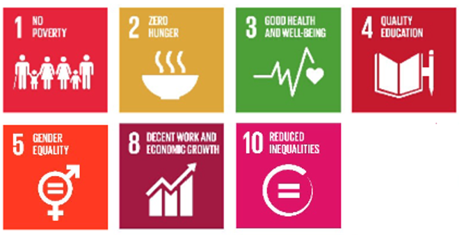

# UK and International

**Overview**

Long-standing and persistent health inequity is as evident in Wales as it is across Europe and the rest of the world. 

The United Nations [2030 Agenda for Sustainable Development](https://www.un.org/sustainabledevelopment/development-agenda/) sets 17 [Sustainable Development Goals](https://www.un.org/sustainabledevelopment/sustainable-development-goals/) (SDGs, or Global Goals) with [Goal 10](https://sdgs.un.org/goals/goal10) explicitly focusing on reducing inequalities; and all other Goals having a direct or indirect impact on people’s wellbeing and the health gap. Particularly relevant Goals are [Goal 1 No poverty](https://sdgs.un.org/goals/goal1); [Goal 2 Zero hunger](https://sdgs.un.org/goals/goal2); G[oal 3 Good Health and Well-being](https://sdgs.un.org/goals/goal3); [Goal 4 Quality education](https://sdgs.un.org/goals/goal4); [Goal 5 Gender Equality](https://sdgs.un.org/goals/goal5) and [Goal 8 Decent work and economic growth](https://sdgs.un.org/goals/goal8).

*SDGs explicitly related to improving health and equity*

 

Improving health and well-being for all, reducing health inequities and ensuring no one is left behind can bring wider economic, social and environmental benefits to populations, contributing to inclusive economic growth and sustainable development. However, progress towards the SDGs across the world has been [stalled by the Coronavirus pandemic](https://www.who.int/news-room/spotlight/the-impact-of-covid-19-on-global-health-goals). 

Aligned with the SDGs, the [WHO’s Thirteenth General Programme of Work 2019–2023](https://www.who.int/about/what-we-do/thirteenth-general-programme-of-work-2019---2023) aims to ensure healthy lives and promote well-being for all at all ages. To drive and facilitate implementation, the [WHO European Office for Investment for Health and Development](https://www.who.int/europe/teams/office-for-investment-for-health-development-(ita)) in Venice, Italy, developed the [Health Equity Status Report initiative (HESRi)](https://www.who.int/europe/initiatives/health-equity-status-report-initiative) looking into the key challenges, opportunities and options to: a) remove the barriers that are holding people back in health and in life; and b) create the conditions for all people to prosper and flourish in health and in life. It also provides a cutting-edge methodology and a suite of tools to promote and support policy action for health equity and well-being. 

Following from this, the first [Resolution on Accelerating progress towards healthy, prosperous lives for all, increasing equity in health and leaving no one behind in the WHO European Region](https://www.euro.who.int/en/about-us/governance/regional-committee-for-europe/past-sessions/69th-session/documentation/resolutions/eurrc69r5-resolution-on-accelerating-progress-towards-healthy,-prosperous-lives-for-all,-increasing-equity-in-health-and-leaving-no-one-behind-in-the-who-european-region) was adopted, recognising that reducing and eradicating health inequities are a necessary contribution to inclusive growth and sustainable development. 

The WHO [European Programme of Work, 2020–2025 “United Action for Better Health in Europe”](https://www.euro.who.int/en/health-topics/health-policy/european-programme-of-work/european-programme-of-work-20202025-united-action-for-better-health-in-europe) has put a strong emphasis on ‘leaving no one behind’ to address the persistent challenge of health inequities across the European Region. In the UK, the [UCL Institute of Health Equity](https://www.instituteofhealthequity.org/) has been leading and collaborating on work to address the social determinants of health and improve health equity, developing and supporting reviews, approaches and capacities. 

There has been a long-standing collaboration between Wales and the WHO, strengthening know-how, capacity and international partnership for improving wellbeing and health equity, preventing and tackling threats to people and society; and achieving sustainable development. The WHO Collaborating Centre on Investment for Health and Well-being (WHO CC) at Public Health Wales has been working closely with the WHO Regional Office for Europe and the European Office for Investment for Health and Development in Venice, Italy to strengthen Wales’ leading role in driving sustainable investment in population wellbeing and health equity, and supporting prosperity for all. Through establishing the WHESRi, Wales has been recognised as a global influencer and a live innovation site for health equity, providing an example and inspiration for other countries and regions; as well as learning from international best practice, expertise and innovative approaches. 

Initiated to inform and support the COVID-19 pandemic response and recovery, the Public Health Wales’ [International Horizon Scanning and Learning reports](https://phwwhocc.co.uk/covid-19/international-horizon-scanning/) provide extensive international evidence on the health, wellbeing, social and economic impacts of COVID-19. These impacts have not been felt equally and have led to [increased health gaps and vulnerabilities](file:///C:/Users/Ma168668/AppData/Local/Microsoft/Windows/INetCache/Content.Outlook/197808WY/Summary%20Report%20on%20the%20impact%20of%20COVID-19%20on%20increasing%20the%20Health%20Gap%20and%20Vulnerability), bringing new and unprecedented challenges for populations, health systems and governments worldwide. They have further exposed social inequities, discrimination and health gaps within and between countries, leading to calls to [‘build back fairer’](https://www.health.org.uk/publications/build-back-fairer-the-covid-19-marmot-review?gclid=EAIaIQobChMIlovsiOeE9wIVluvtCh0KRQqFEAAYASAAEgL63_D_BwE). The reports have now expanded in scope to include priority public health topics. 

**The Five Essential Conditions**

This section contains examples of resources from around the world on the nature and impacts of health inequalities. It links the resources to the Five Essential Conditions for health of the Health Equity Status Report initiative. These resources include:

* Research articles in peer-reviewed academic journals
* Reports from key international organisations
* Policy briefs
* Research briefs 

>**Stay up to date.** The Welsh Health Equity Solutions Platform is continuously updated with latest resources and materials, including data, policies, reports and case studies. [Contact us](mailto:solutionsplatform@wales.nhs.uk) to be notified of updates to the Solutions Platform. 

> **Get in touch to get involved.** We are working with stakeholders and users to update and expand the Solutions Platform with projects, case studies and spotlight features focused on health equity. [Contact us](mailto:solutionsplatform@wales.nhs.uk) to share your projects and success stories, to feature on the platform.

### Useful resources:

**World Health Organization** [Health Equity Status Report initiative](https://www.who.int/europe/initiatives/health-equity-status-report-initiative) aiming to shift political and policy focus from describing the problem to capturing progress and enabling action to increase equity in health.

**World Health Organization** [Social determinants of health](https://www.who.int/health-topics/social-determinants-of-health#tab=tab_1) presenting information on inequities in health and how they are socially determined, preventing poorer populations from moving up in society and making the most of their potential.

**World Health Organization** [The WHO Global Webinar Series on Equity, COVID-19 and the Social Determinants of Health](https://www.who.int/teams/social-determinants-of-health/equity-and-health/webinar-series) exploring the disproportionate impacts that the COVID-19 pandemic is having on more disadvantaged population groups, with a focus on how it is widening health inequities.

**Joint Action Health Equity Europe** ([JAHEE](https://jahee.iss.it/)) contributing to efforts to achieve greater equity in health outcomes across all groups in society in participating countries and in Europe at large and to reduce inter-country heterogeneity in tackling health inequalities.

**The Centre for Global Health Inequalities Research** ([CHAIN](https://www.ntnu.edu/chain#/view/about)) bringing together researchers from global regions and different research disciplines to advance the current state-of-the-art by offering new insights from social, laboratory-based and natural experiments into the casual mechanisms linking socioeconomic status and health.   

**EuroHealthNet** [Health Inequalities Portal](https://health-inequalities.eu/), an information hub on health inequalities in Europe providing information on a range of areas, such as finance, data, initiatives and tools.

**The Lancet Group** [Advancing Equity, Diversity, and Inclusion](https://www.thelancet.com/equity-diversity-inclusion) advancing equity, diversity, and inclusion (EDI) as a commitment to health for all.

**The Health Foundation** [Evidence Hub: What drives health inequalities?](https://health.org.uk/evidence-hub?msclkid=9c4fec7fab7d11eca7baa68b38534b40), providing data, insights and analysis exploring how the circumstances in which we live shape our health.

**University College London** [Institute of Health Equity](https://www.instituteofhealthequity.org/?msclkid=8accf016ab7d11ec8a401ee11645c4fd) supporting greater health equity by building the evidence base, influencing action that works, and building capacity. 
