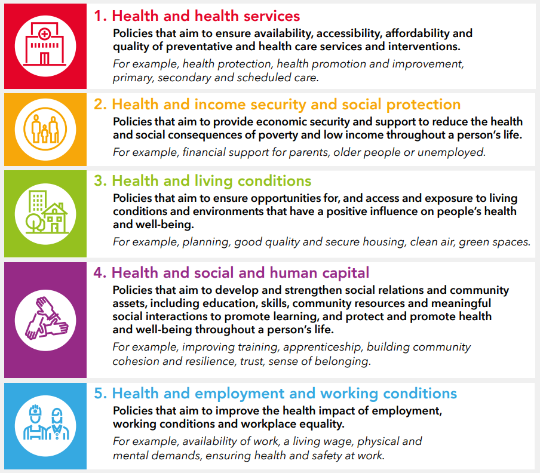

```{r, include = FALSE}
health = "health" %in% params$conditions
income = "income" %in% params$conditions
living = "living" %in% params$conditions
social = "social" %in% params$conditions
employment = "employment" %in% params$conditions
conditions_table = data.frame(
  key = c("health", "income", "living", "social", "employment"),
  EN = c("Health Services",
         "Income Security and Social Protection",
         "Living Conditions",
         "Social and Human Capital",
         "Employment and Working Conditions"))
info_table = data.frame(key = c("economics", "policy", "evidence", "needs", "solutions"),
                        EN = c("Health Economics", "Policies", "International Evidence", "Un-met Needs", "Solutions"))
```

```{r, child = "report_overview.md"}
```

This report contains information about the following essential conditions(s):

```{r, echo = FALSE, eval = TRUE, results = "asis"}
rep_conditions_raw = as.vector(params$conditions)
rep_conditions = paste("-", conditions_table$EN[which(rep_conditions_raw %in% conditions_table$key)])
cat(rep_conditions, sep = "\n")
``` 

for the following topic(s):

```{r, echo = FALSE, eval = TRUE, results = "asis"}
rep_info_raw = as.vector(params$info)
rep_info = paste("-", info_table$EN[which(rep_info_raw %in% info_table$key)])
cat(rep_info, sep = "\n")
``` 



\newpage

```{r, child = if (health) "health_overview.md"}
```
```{r, child = if (health) unlist(purrr::map(.x = params$info, .f = ~ glue::glue("../pages/{.x}_health.md")))}
```
```{r, echo = FALSE, results = "asis"}
if ("health" != tail(params$conditions, 1)) {
  cat("\n\n\\pagebreak\n")
}
```

```{r, child = if (income) "income_overview.md"}
```
```{r, child = if (income) unlist(purrr::map(.x = params$info, .f = ~ glue::glue("../pages/{.x}_income.md")))}
```
```{r, echo = FALSE, results = "asis"}
if ("income" != tail(params$conditions, 1)) {
  cat("\n\n\\pagebreak\n")
}
```

```{r, child = if (living) "living_overview.md"}
```
```{r, child = if (living) unlist(purrr::map(.x = params$info, .f = ~ glue::glue("../pages/{.x}_living.md")))}
```
```{r, echo = FALSE, results = "asis"}
if ("living" != tail(params$conditions, 1)) {
  cat("\n\n\\pagebreak\n")
}
```

```{r, child = if (social) "social_overview.md"}
```
```{r, child = if (social) unlist(purrr::map(.x = params$info, .f = ~ glue::glue("../pages/{.x}_social.md")))}
```
```{r, echo = FALSE, results = "asis"}
if ("social" != tail(params$conditions, 1)) {
  cat("\n\n\\pagebreak\n")
}
```

```{r, child = if (employment) "employment_overview.md"}
```
```{r, child = if (employment) unlist(purrr::map(.x = params$info, .f = ~ glue::glue("../pages/{.x}_employment.md")))}
```
```{r, echo = FALSE, results = "asis"}
if ("employment" != tail(params$conditions, 1)) {
  cat("\n\n\\pagebreak\n")
}
```
